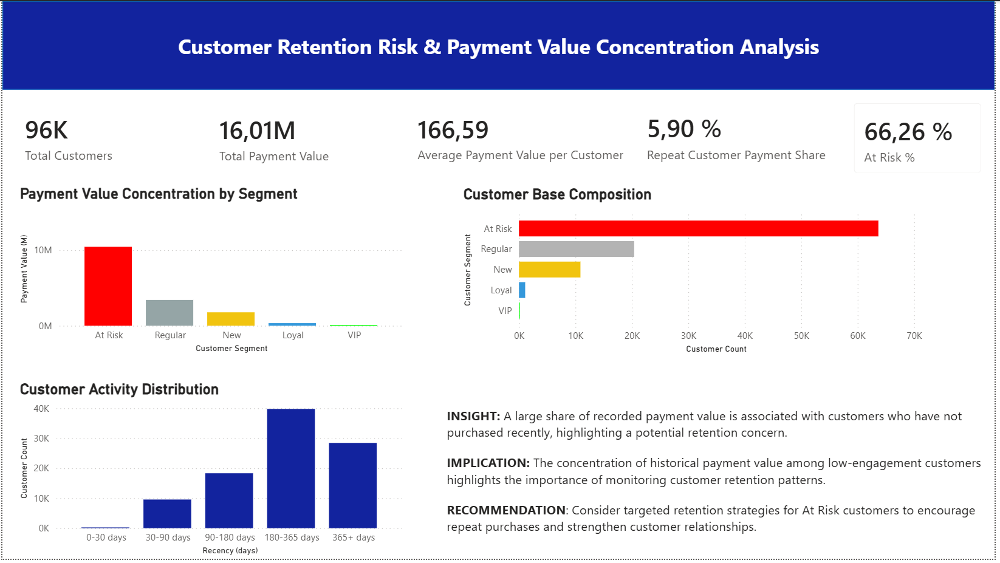

# Customer Retention Risk & Payment Value Concentration Analysis

## Table of Contents

1. [Project Overview](#project-overview)
2. [Business Problem](#business-problem)
3. [Dashboard Preview](#dashboard-preview)
4. [Key Findings](#key-findings)
5. [Why This Matters](#why-this-matters)
6. [Tech Stack](#tech-stack)
7. [Project Structure](#project-structure)
8. [Environment Variables](#environment-variables)
9. [Data Pipeline](#data-pipeline)
   - [Data Ingestion (Python)](#data-ingestion-python)
   - [Data Modeling (SQL)](#data-modeling-sql)
   - [Step 1: Payment Aggregation](#step-1-payment-aggregation)
   - [Step 2: Customer Base](#step-2-customer-base)
   - [Step 3: RFM Metrics](#step-3-rfm-metrics)
   - [Step 4: Customer Segmentation](#step-4-customer-segmentation)
10. [Dashboard](#dashboard)
    - [Key Metrics](#key-metrics)
11. [Business Interpretation](#business-interpretation)
    - [Insight](#insight)
    - [Implication](#implication)
    - [Recommendation](#recommendation)
12. [Technical Trade-offs & Decisions](#technical-trade-offs--decisions)
13. [How to Run](#how-to-run)
    - [Prepare the Environment](#1-prepare-the-environment)
    - [Install Dependencies](#2-install-dependencies)
    - [Download and Prepare the Dataset](#3-download-and-prepare-the-dataset)
    - [Configure the MySQL Database](#4-configure-the-mysql-database)
    - [Load Raw Data into MySQL](#5-load-raw-data-into-mysql)
    - [Execute SQL Scripts](#6-execute-sql-scripts)
    - [Open the Dashboard](#7-open-the-dashboard)
14. [What This Project Demonstrates](#what-this-project-demonstrates)
15. [Dataset](#dataset)
16. [Final Thought](#final-thought)
17. [License](#license)


## Project Overview

This project analyzes customer purchasing behavior in an e-commerce dataset to examine **customer retention patterns and payment value concentration**.

The goal is to answer a key business question:

> How much does the business depend on repeat customers, and what historical purchasing patterns may indicate potential retention risks?

## Business Problem

Customer acquisition alone does not guarantee long-term customer retention.

This project investigates repeat purchasing behavior, customer inactivity and the distribution of payment value across customer segments to identify patterns that may help inform retention strategies.

## Dashboard Preview



## Key Findings

- **66.26% of customers (63,676 out of 96,095)** are classified as At Risk, based on a recency threshold of more than 200 days since their last recorded purchase.
- **Only 5.90% of total recorded payment value** comes from repeat customers, defined as customers with more than one order.
- The At Risk segment accounts for **65.24% of total recorded payment value**, showing a concentration of historical payment value among customers with low recent activity.
- The analysis is historical and rule-based, using **October 17, 2018** as the reference date for recency calculations. The At Risk classification is based on historical purchasing behavior and does not predict future customer churn.
- Payment values include orders with payment records regardless of their order status. Therefore, they should not be interpreted as net revenue or revenue from delivered orders.

## Why This Matters

The analysis shows that most customers have no recent recorded purchase, while a large share of historical payment value is associated with this segment.

This highlights a potential customer retention concern and provides a basis for further investigation and targeted retention strategies. However, the analysis does not establish whether these customers will return or predict future revenue.

## Tech Stack

- **Python:** Data ingestion and date handling.
- **Pandas:** CSV processing and data preparation.
- **SQLAlchemy:** Database connection and data loading.
- **MySQL:** Data storage, aggregation, RFM calculations and customer segmentation.
- **Power BI:** Dashboard development and business analysis.
- **DAX:** KPI calculations and customer activity grouping.
- **Git & GitHub:** Version control and project publishing.

## Project Structure

```text
customer retention risk analysis/
├── dashboard/
│   └── Customer Retention & RFM Analysis.pbix
├── data/
│   ├── olist_customers_dataset.csv
│   ├── olist_order_payments_dataset.csv
│   └── olist_orders_dataset.csv
├── python/
│   └── load_to_mysql.py
├── reports/
│   └── Customer_Retention_RFM_Analysis.png
├── sql/
│   ├── 01_create_tables.sql
│   ├── 02_customer_base.sql
│   ├── 03_rfm.sql
│   └── 04_rfm_segments.sql
├── .env.example
├── .gitignore
├── LICENSE
├── README.md
└── requirements.txt
```

The `.env` file containing database credentials is intentionally excluded from the project repository.

## Environment Variables

Database connection settings are managed through environment variables loaded from a `.env` file using `python-dotenv`.

Create a `.env` file in the project root using `.env.example` as a template:

```env
DB_USER=your_user
DB_PASSWORD=your_password
DB_HOST=localhost
DB_PORT=3306
DB_NAME=retail_customer_intelligence
```

The `.env` file should not be committed to version control.

**Important:** The database name must remain `retail_customer_intelligence`, as the SQL scripts explicitly select this database using `USE` statements. If you change the database name, you must also update the corresponding SQL scripts.

## Data Pipeline

### Data Ingestion (Python)

The Python ingestion script (`load_to_mysql.py`) loads the original CSV datasets into MySQL.

- **Data Loading:** Uses Pandas to read the customers, orders and order payments CSV files and load them into MySQL through SQLAlchemy.
- **Data Typing:** Converts the relevant order date columns to datetime objects during ingestion to support subsequent SQL date calculations.
- **Credential Management:** Reads database connection settings from environment variables stored in `.env`.
- **Table Replacement:** Uses `pandas.to_sql()` with `if_exists='replace'` to create or replace the three raw data tables.

The script is designed for straightforward local execution. It loads the CSV files into memory and replaces the corresponding database tables when executed.

### Data Modeling (SQL)

The SQL pipeline transforms the raw tables into a customer-level dataset suitable for RFM analysis.

#### Step 1: Payment Aggregation

Payment records are aggregated by `order_id` to calculate the total recorded payment value for each order.

```sql
CREATE TABLE order_payments_agg AS
SELECT
    order_id,
    SUM(payment_value) AS total_payment
FROM order_payments
GROUP BY order_id;
```

This prevents orders with multiple payment records from being duplicated in the subsequent customer analysis.

#### Step 2: Customer Base

The aggregated payment data is joined with the customers and orders tables to create an order-level dataset.

The resulting `customer_orders_base` table contains:

- Customer identifier (`customer_unique_id`).
- Order identifier (`order_id`).
- Purchase timestamp.
- Total recorded payment value for each order.

The query uses INNER JOIN operations, so only orders with an associated customer and at least one payment record are included. No order status filter is applied.

### Step 3: RFM Metrics

RFM metrics are calculated at customer level using `customer_unique_id`.

- **Recency:** Number of days since the customer's most recent recorded purchase, relative to the latest purchase date in the dataset.
- **Frequency:** Number of distinct orders placed by the customer.
- **Monetary:** Sum of recorded payment values associated with the customer's orders.

The resulting `rfm_table` contains one row per customer.

The reference date is the latest purchase date available in the dataset (October 17, 2018).

### Step 4: Customer Segmentation

Customers are classified into five segments based on rule-based RFM scores:

- **VIP:** Highest scores across recency, frequency and monetary value.
- **Loyal:** Recent purchasing activity and at least two orders.
- **New:** Recent purchasing activity and only one order.
- **At Risk:** More than 200 days since the last recorded purchase.
- **Regular:** Customers who do not meet the conditions of the other segments.

The segmentation uses predefined thresholds:

| Metric | Score 1 | Score 2 | Score 3 |
|---|---|---|---|
| Recency | More than 200 days | 101–200 days | 0–100 days |
| Frequency | 1 order | 2 orders | 3 or more orders |
| Monetary | Less than 200 BRL | 200–499.99 BRL | 500 BRL or more |

These segments are based on historical purchasing behavior and predefined business rules. They are not predictive classifications.

## Dashboard

The Power BI dashboard consists of a single page designed to provide an overview of customer retention patterns and payment value concentration.

### Key Metrics

- **Total Customers:** 96,095 customers included in the RFM analysis.
- **Total Payment Value:** 16,008,872.12 BRL in recorded payment value.
- **Average Payment Value per Customer:** 166.59 BRL.
- **Repeat Customer Payment Share:** 5.90% of total recorded payment value associated with customers who placed more than one order.
- **At Risk Customers:** 66.26% of the analyzed customer base.

The dashboard also includes three visualizations:

- **Payment Value Concentration by Segment:** Compares recorded payment value across the five customer segments.
- **Customer Base Composition:** Shows the number of customers in each segment.
- **Customer Activity Distribution:** Groups customers according to recency: 0–30, 31–90, 91–180, 181–365 and 366+ days.

The dashboard uses DAX measures to calculate the main KPIs and organize customer activity data.

## Business Interpretation

### Insight

The At Risk segment represents 66.26% of the analyzed customers and accounts for 65.24% of total recorded payment value.

This indicates that a substantial share of historical payment value is associated with customers who have not purchased recently.

### Implication

The concentration of historical payment value among customers classified as At Risk highlights a potential retention concern.

The analysis does not determine whether these customers will return or quantify its impact on future business performance.

### Recommendation

Consider testing targeted retention initiatives, such as re-engagement campaigns and personalized offers, to encourage repeat purchases among customers with low recent activity.

The effectiveness of these strategies would need to be evaluated through further analysis.

## Technical Trade-offs & Decisions

- **Data Loading:** The ingestion script uses `pandas.to_sql()` with `if_exists='replace'` to simplify the initial loading process. This approach replaces existing raw tables and does not preserve SQL-defined primary key and foreign key constraints.
- **Schema Reference:** `01_create_tables.sql` documents the intended raw table schema and relationships. It is provided for reference and is not part of the execution pipeline, since the Python loader creates the raw tables.
- **Historical Analysis:** The dataset ends in 2018. Recency is therefore calculated relative to the latest purchase timestamp in the dataset (October 17, 2018), rather than the current date.
- **Rule-Based Segmentation:** RFM thresholds are predefined business rules used to classify historical customer behavior. They have not been statistically validated as predictors of future customer inactivity.
- **Payment Value Scope:** The analysis includes payment records from orders regardless of order status. It should therefore be interpreted as recorded payment value rather than net or delivered-order revenue.

## How to Run

### 1. Prepare the Environment

Clone or download the project repository from GitHub.

Create and activate a virtual environment:

**Windows:**
```bash
python -m venv venv
venv\Scripts\activate
```

**Mac/Linux:**
```bash
python3 -m venv venv
source venv/bin/activate
```

### 2. Install Dependencies

Install the required Python libraries:

```bash
pip install -r requirements.txt
```

### 3. Download and Prepare the Dataset

Download the [Brazilian E-Commerce Public Dataset by Olist](https://www.kaggle.com/datasets/olistbr/brazilian-ecommerce).

Place the following CSV files inside the project's `data/` directory:

- `olist_customers_dataset.csv`
- `olist_orders_dataset.csv`
- `olist_order_payments_dataset.csv`

### 4. Configure the MySQL Database

Make sure MySQL is installed and running.

Create the project database:

```sql
CREATE DATABASE retail_customer_intelligence;
```

Create a `.env` file in the project root using `.env.example` as a template, and configure the database connection:

```env
DB_USER=your_username
DB_PASSWORD=your_password
DB_HOST=localhost
DB_PORT=3306
DB_NAME=retail_customer_intelligence
```

### 5. Load Raw Data into MySQL

Run the Python ingestion script from the project root:

```bash
python python/load_to_mysql.py
```

This script loads the three CSV files into MySQL and creates or replaces the following raw tables:

- `customers`
- `orders`
- `order_payments`

### 6. Execute SQL Scripts

Execute the following SQL scripts in MySQL, in this order:

1. `02_customer_base.sql` — performs payment aggregation and customer base creation.
2. `03_rfm.sql`
3. `04_rfm_segments.sql`

**Note:** `01_create_tables.sql` is included as a schema reference and is not part of the execution pipeline. The Python ingestion script creates the raw tables.

The SQL scripts use `DROP TABLE IF EXISTS` before creating derived tables, allowing them to be executed again without manually removing previously generated tables.

### 7. Open the Dashboard

Open `Customer Retention & RFM Analysis.pbix` from the `dashboard/` folder using Power BI Desktop.

## What This Project Demonstrates

- Building an end-to-end data workflow using Python, MySQL and Power BI.
- Loading and preparing raw CSV datasets for analysis.
- Using SQL joins and aggregations to build customer-level analytical tables.
- Calculating RFM metrics and implementing rule-based customer segmentation.
- Creating Power BI dashboards and DAX measures to analyze customer behavior.
- Translating historical data patterns into business insights and potential retention initiatives.

## Dataset

This project uses the **Brazilian E-Commerce Public Dataset by Olist**, published on Kaggle.

- **Original source:** [Brazilian E-Commerce Public Dataset by Olist](https://www.kaggle.com/datasets/olistbr/brazilian-ecommerce)
- **Provider:** Olist.
- **Description:** An anonymized dataset containing approximately 100,000 e-commerce orders from 2016 to 2018.
- **License:** [CC BY-NC-SA 4.0](https://creativecommons.org/licenses/by-nc-sa/4.0/).

The analysis focuses on the customer, order and payment datasets used in this project.

The dataset is provided by Olist and is used here for non-commercial analytical and educational purposes.

## Final Thought

Understanding repeat purchasing behavior and customer inactivity is essential to evaluating retention patterns and identifying opportunities for further analysis.

## License

This project is licensed under the MIT License. See the `LICENSE` file for details.
